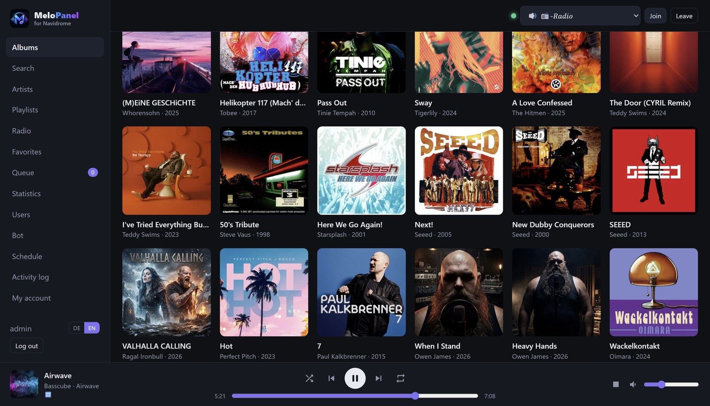
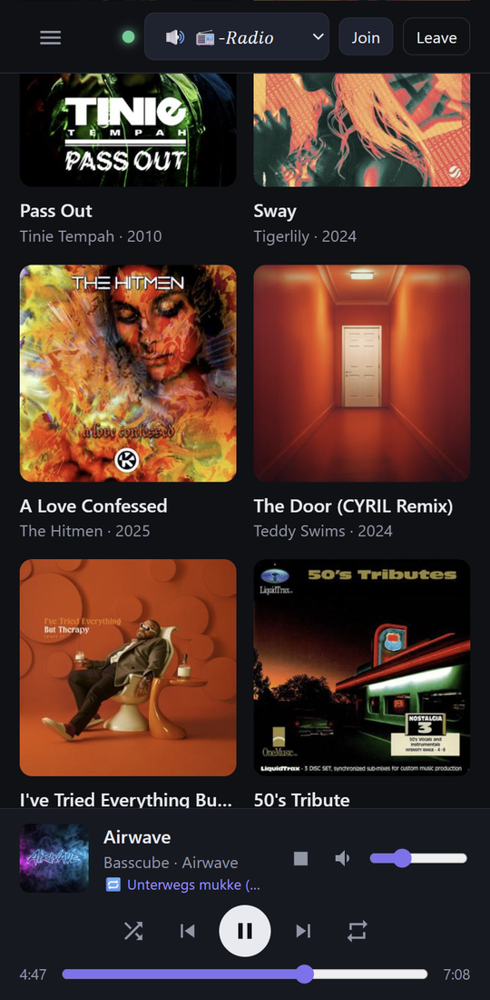

<p align="center">
  
</p>

<p align="center">
  <b>Discord music bot with a web panel for <a href="https://www.navidrome.org/">Navidrome</a></b><br>
  Music, internet radio, favorites lists and nonstop playback in your Discord voice channel –
  controlled from the browser or with slash commands.
</p>

<p align="center">
  📖 <a href="https://instructions.whazza.de/melopanel/"><b>Full guide (English &amp; Deutsch)</b></a>
</p>

---

<p align="center">
  
  &nbsp;
  
</p>

## Features

- 🎶 **Music** – albums, artists, playlists and search from Navidrome; play now, play next or add to the queue
- 📻 **Radio** – internet radio stations from Navidrome, showing the song currently on air
- ♥ **Favorites lists** – your own lists in the panel, also as nonstop playback (in order or shuffled)
- 🔁 **Always on** – stays in the channel and rejoins by itself after restarts or disconnects
- 🕒 **Schedule** – start a favorites list or station at fixed times, or stop the music
- 📊 **Statistics & activity log** – most played tracks and artists, and who did what when
- 🔊 **Loudness normalization** and the current track as the bot's **Discord status**
- 🔐 **Permissions** – panel accounts with an admin role; DJ role and bot channel in Discord
- 🌍 **German & English** – in the panel and in Discord (follows each user's language)
- ❤️‍🩹 **Health endpoint** for uptime monitors such as Uptime Kuma
- 📱 Works on desktop and mobile

## Quick start

**Requirements:** a Linux server with Docker and Docker Compose, a running Navidrome, and a Discord bot
([Discord Developer Portal](https://discord.com/developers/applications) → New Application → Bot → Reset Token;
invite it with the scopes `bot` and `applications.commands`).

```bash
# 1. Copy the contents of the Installation folder to the server
cd /opt/melopanel

# 2. Create and fill in the settings
cp .env.example .env
nano .env          # DISCORD_TOKEN, DISCORD_GUILD_ID, NAVIDROME_USER/PASSWORD, SECRET_KEY, ...

# 3. Start
docker compose up -d --build
docker compose logs -f
```

The panel is then available at `http://127.0.0.1:8095` on the server – put it behind a reverse proxy
(Apache/Nginx) with your own domain, or open it directly via the server's IP address.
Log in with the admin account from `.env`, pick a voice channel and click **Join**. 🎉

`docker-compose.yml` assumes that Navidrome also runs in Docker (network `navidrome_default`).
Everything else – Navidrome outside Docker, domain and HTTPS, IP-only access, updates, backups, all panel
features and Discord commands, troubleshooting – is covered in the
**[full guide](https://instructions.whazza.de/melopanel/)**.

## Folders

| Folder | Contents |
|---|---|
| `Installation/` | Everything that goes onto the server (program, Docker files, `.env.example`) |
| `docs/` | Screenshots for this page |

## Kurz auf Deutsch

MeloPanel ist ein Discord-Musikbot mit Webpanel für Navidrome. Inhalt von `Installation/` auf den Server
kopieren, `.env.example` zu `.env` kopieren und ausfüllen, `docker compose up -d --build` – fertig.
Alle Details stehen in der **[Anleitung](https://instructions.whazza.de/melopanel/)** (Deutsch & Englisch,
oben links umschaltbar).

## License

[MIT](LICENSE)

MeloPanel is an independent project and not an official product of Navidrome or Discord.
Navidrome and Discord are trademarks of their respective owners.
